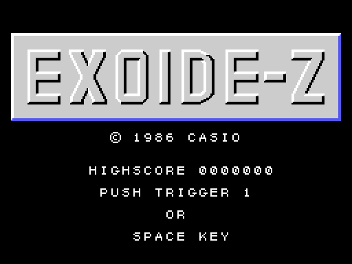
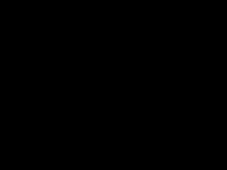
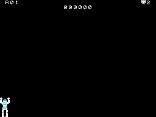
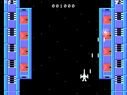
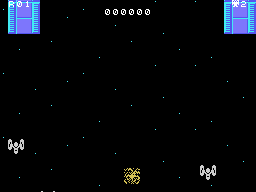
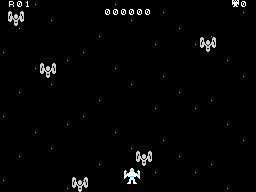

# The game

*Exoide-Z* is a vertical-scrolling shoot'em up: a ship flies up over a space station shooting the enemies that come
in waves and the targets on the ground; at the end of the station the ship turns into a robot and fights a big
robot with its fists. The rounds are in [The rounds](THE-ROUNDS.html).

Every GIF on this site is the ROM **running in openMSX** (a Japanese MSX1 with C-BIOS, at 60 frames per second):
on every frame the VRAM, the RAM and the VDP registers are logged, and `tools/vdp.py` paints them.

## The intro and the title

At power-on, four CASIO logos come in from the sides, the top and the bottom and meet in the middle, with a sound
(`presentacion`, 0x40E5). Then the title: EXOIDE-Z in big letters, the high score and PUSH TRIGGER 1 OR SPACE KEY
(`titulo`, 0x42EF). The title waits for the button **inside the interrupt**: while it waits not a single frame
goes by (`titulo_espera`, 0x47AE). With no button, about seven seconds later the **demo** starts, with the stick
set at random every 32 frames and the button always pressed (`nave_mandos`, 0x634F).

## The controls

| | joystick | keyboard |
|---|---|---|
| move the ship | joystick 1 | the cursor keys |
| fire | the button | the space bar |

What is pressed on the title decides: the space bar plays with the keyboard and the joystick 1 button with the
joystick (0xE098). The ship moves in eight directions within the screen (the table at 0x6440) and has up to **four
shots** at a time, which go up 4 dots per frame; with the button held, one comes out every 16 frames
(`tarea_disparos`, 0x64BE).

## The lives

The game starts with **two spare lives** (`partida_borra`, 0x4045), their number at the top right. One is lost when
the ship hits an enemy or a shot (`nave_choca`, 0x6460): it blows up and the round starts again, from the
beginning of the station or, with lives lost in it, from 32 pieces further on (`fondo_pon`, 0x5480). With no spare
lives, **GAME OVER**, written with sprites (`game_over`, 0x4932). There is an extra life at **50,000** points and
another every **100,000** (`vida_mas`, 0x4BDC), and another if the three capsules end on the good drawing ([The
rounds](THE-ROUNDS.html)).

## The points

They are added by classes, each with its digits in the table at 0x4C3B (`tarea_puntos`, 0x4B89):

- An enemy, **100**.
- A ground target of the counted kind (tile 0xC8), **300**.
- The other ground ones (0xE0) hold out: one in sixteen shots that hit them breaks them, for **1,000**.
- Each punch on the big robot, **200**; broken, **1,000**.
- At the end of the station, the **BONUS** of the count, a hundred at a time.
