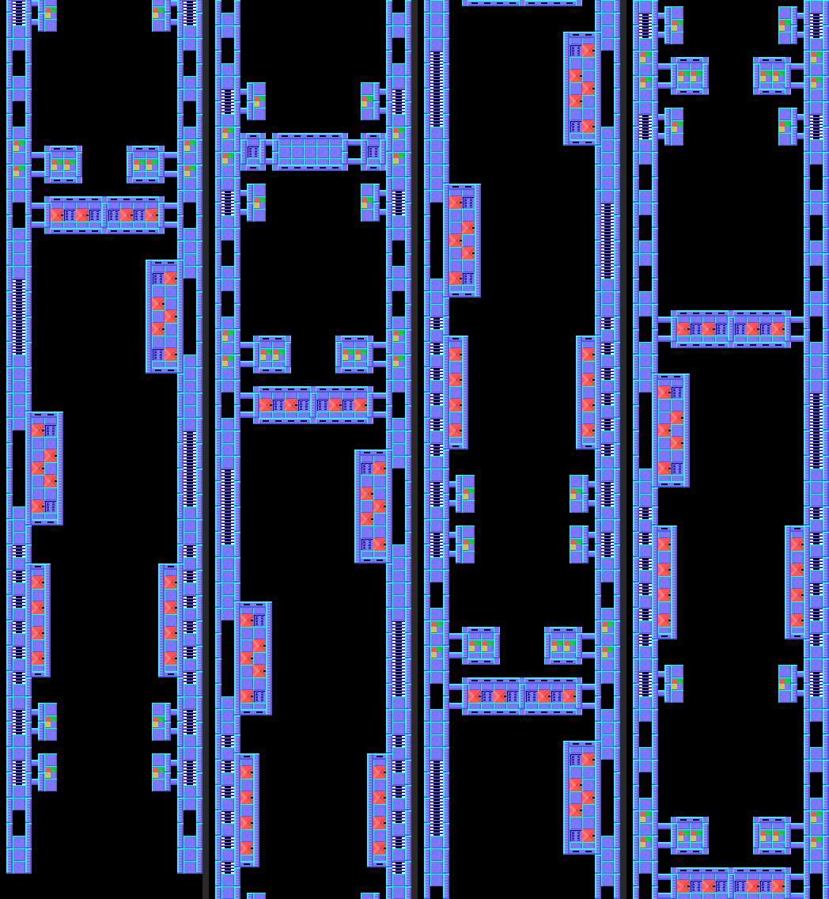
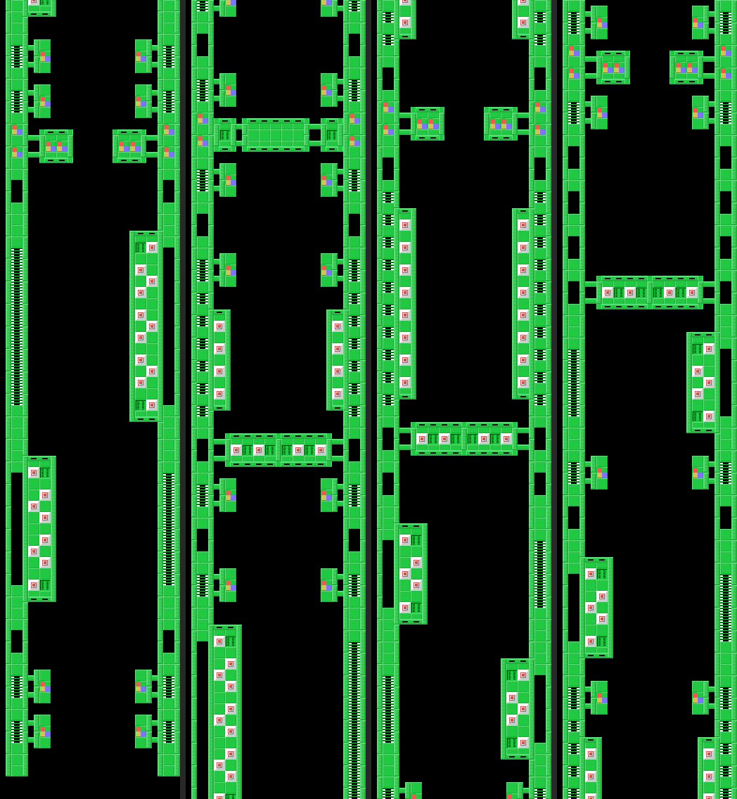
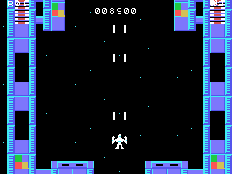
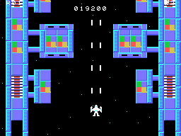
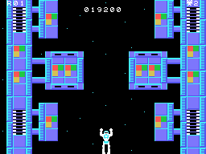
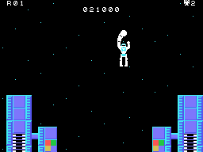

# The rounds

Each round is one pass over the station: the ship comes in at the bottom, the screen goes up the station to its
end, the ship transforms and fights the big robot, and a count adds up the broken targets. Then the next round:
four stations with their own drawing and colours (the round & 3) and the waves of the first eight rounds, which
then repeat from 4 to 7 (`ronda_datos`, 0x4890).

## The station

The station is not a picture: the game builds it piece by piece as it goes up. There are 16 **pieces** of 8 rows
of 32 tiles, packed (0x56D9), and each round has a **list** with the pieces in order (0x4999); after it comes the
list of the end, the same for all (0x4AA5). The scroll feeds each piece in at the top row by row and moves with two
name tables taking turns: while one is shown, the other is filled a third at a time (`tarea_scroll`, 0x54D9;
`tarea_mapa`, 0x5562). The background stars are eight tiles with the star one row lower each time
(`estrellas_casillas`, 0x614F).

The maps on this page are built with the ROM's code (`tools/mapas.py`: piece 0, the round's list and the end
list, each piece unpacked with its commands) and painted with the tiles of the VRAM recorded in openMSX in that
round. They come in four strips: the first, on the left, is the start (the bottom), and each strip reads from the
bottom up, the way the screen goes up.

## The enemies

They come in waves: each round has a list of classes (0x4AAD), and each class says how they come in and how they
move (the class / 4, `tarea_oleada`, 0x696C, and `tarea_enemigos`, 0x6C1F). Up to eight at a time:

| classes | come in | move |
|---|---|---|
| 0-3 | four at a time from one side | in a spiral (`mueve_forma0`, 0x6C90) |
| 4-7 | from eight fixed places | down; 5 sideways in jumps, 6 diagonally, 7 down to the ship's row |
| 8-11 | from the top, each in its column | down; 9 dives on the ship, the others veer towards it |
| 12-15 | from the top, near the ship | in three parts: straight, sideways to its column and diving |
| 16-19 | four at a time | in a spiral, lower down |

They shoot at the ship only if it is in their row, column or diagonal (`apunta`, 0x6F8E).

## The ground targets

Two kinds of tiles break with the shots (`disparo_suelo`, 0x65DF): **0xC8** (300 points), which are counted for
the count, and **0xE0**, which only break once in sixteen (1,000 points). Broken, tiles 0x90-0x9F stay in their
place in both name tables and in RAM.

## The capsules

In piece 6 three **capsules** come down (`estado_capsulas`, 0x75EE). Each shot that hits them makes them spin among
four drawings; when the three stop, they are checked (`capsulas_premio`, 0x771B): the three on the first drawing
give **a life and faster shots** (8 dots per frame instead of 4); the three on the other, **the enemies stop
shooting**; mixed, nothing.

## The end: the big robot

When the end list is over, the ship goes on its own to the middle of the screen and **transforms** into a robot
(`estado_fin_mapa`, 0x675F, and `estado_transforma`, 0x67BA). Then the **big robot** comes, blinks and goes from
side to side coming down little by little (`tarea_robot_grande`, 0x7199). The transformed ship moves the same way
and the button throws a **punch** (`tarea_robot_golpe`, 0x6898): five punches break it (`robot_grande_golpe`,
0x72AE). If the big robot reaches the bottom, it leaves: the ship is a ship again and the station starts over, and
each escape is counted (0xE0C3): from the fourth on, the enemies shoot twice as fast and in every direction.

## The count

With the big robot broken, a screen counts the 0xC8 targets there were and the broken ones, the percentage
(**RATE**) and the prize (**BONUS**), which goes into the score a hundred at a time (`recuento`, 0x73A4;
`estado_bonus`, 0x7589). The loop checks six steps; with 100% it fits none of them and stays on the seventh in the
table:

| RATE | BONUS |
|---|---:|
| below 50% | 0 |
| from 50% | 5,000 |
| from 60% | 10,000 |
| from 70% | 15,000 |
| from 80% | 20,000 |
| from 90% | 30,000 |
| 100% | 100,000 |

