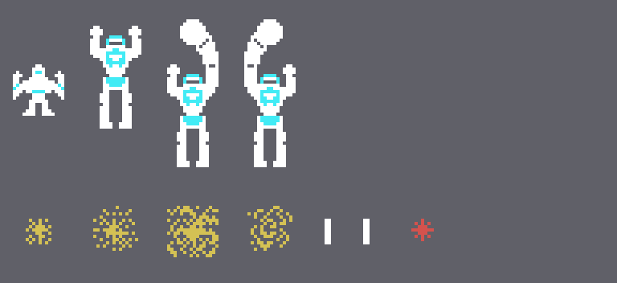
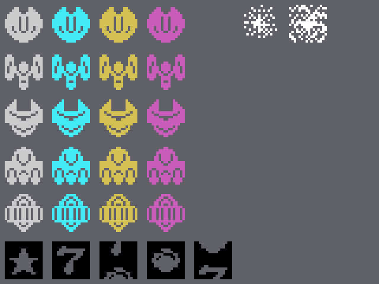
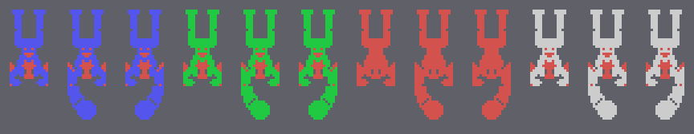
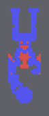

# The sprites

Everything on this page is **put together from the ROM** with `tools/hojas.py`. The game makes its own sprite
drawings in the VRAM, with mirror copies (the bits of each byte reversed), swapped halves and copies turned upside
down (`pantalla_pon`, 0x7834, and `sprites_3c00`, 0x78D8), so here those two routines are **run** with the Z80 of
`tools/bios.py` and the drawings are taken from what they leave at 0x3800. None of these images is a screenshot.

**Checked against openMSX** on the four recordings of this site:

- the drawing table left by the ROM run here (VRAM 0x3800-0x3F3F) is **identical** to the game's on 30,269 frames;
  on 972 more the GAME OVER letters are at 0x3D20-0x3DBF (the game copies them there from the BIOS font, 0x4953),
  and on 759 `sprites_3c00` has not run yet; **0 different**. The score and the lives (0x3F40-0x3FFF) are painted
  by the game with the BIOS letters and are not used here;
- the ship and its shadow (0xE219 and 0xE27D) match on 22,246 frames, **0 different** (48 more with the shadow
  transparent, at the end of the station);
- the transformed ship matches on 5,306 frames, **0 different** (210 more while it comes in or transforms, with the
  pieces apart);
- the enemies (0xE2BD, the sprite 0xE245 + 4 × their number) have the drawing and colour of their class on
  **45,717 frames, 0 different**;
- the big robot, on all its 381 frames, **0 different**.

## The ship and the robot

The ship is two sprites in the same place: 0x00 in white and its shadow 0x04 in cyan (0x6276). At the end of
the station it becomes the robot (`estado_transforma`, 0x67BA): 0x80 with 0x84 under it, in white, and the shadow
0x88 three dots lower; every round also starts with this robot walking in from the left (0x626A) until it becomes
the ship. With the button the robot punches (`tarea_robot_golpe`, 0x6898): the body 0x98 with the arm 0xA8 above
it, or 0x9C with 0xB0, one and the other. Below, the ship blowing up (0xD8, 0xDC, 0xE0 and 0xE4 in dark yellow,
`nave_explota` 0x63D2), its shot (0x08, white) and the enemies' shot (0xD4, dark red):

## The enemies

The drawing of each enemy comes from its class: (class & 0xFC) + 0x0C, and the colour from the table at 0x6A05 by
class & 3: grey, cyan, dark yellow and magenta (`sale_sprite`, 0x69E4). Five drawings, one for each of the
five ways of coming out (`tarea_oleada`, 0x696C). Hit, they become 0xDC at frame 3 and 0xE0 at frame 11, in white,
and go away at frame 19 (`tarea_tocados`, 0x7071). At the bottom, the capsules (0x6C-0x7C, black: the drawing is
the hole, `tarea_capsulas` 0x7635):

The ship blowing up (0xD8 + 4 every 8 frames, three times) and an enemy hit, at the game's pace:

## The big robot

Four sprites (0x70BD): 0x8C with 0x90 above it in the colour of the round (0x70CD: dark blue, green, dark red and
grey), 0x94 behind it in dark red, and a fourth one below, transparent. When it moves its arms (`tarea_robot_grande_brazo`,
0x733D) 0x8C becomes 0xA0 with 0xAC below it, or 0xA4 with 0xB4, one and the other; each round, quiet and with the
two arms:

The arms 12 frames and then quiet 96, at the game's pace:

