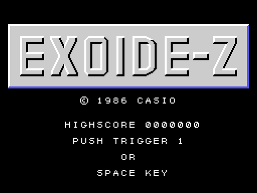
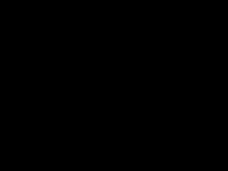
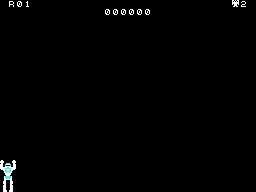
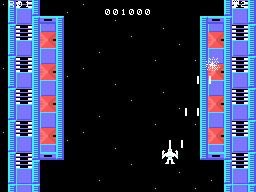
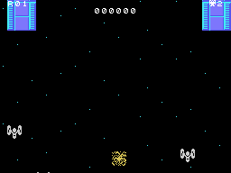
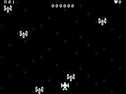

# La partida

*Exoide-Z* es un matamarcianos de scroll vertical: una nave sube por encima de una estación espacial disparando a
los enemigos que vienen en oleadas y a los blancos del suelo; al final de la estación la nave se transforma en un
robot y pelea a puñetazos con un robot grande. Las rondas están en [Las rondas](LAS-RONDAS.html).

Todos los GIF de esta web son la ROM **funcionando en openMSX** (un MSX1 japonés con C-BIOS, a 60 cuadros por
segundo): en cada cuadro se apuntan la VRAM, la RAM y los registros del VDP, y `tools/vdp.py` los pinta.

## La presentación y el título

Al encender, cuatro CASIO entran por los lados y por arriba y abajo y se juntan en el centro, con un sonido
(`presentacion`, 0x40E5). Después, el título: EXOIDE-Z en letras grandes, el récord y PUSH TRIGGER 1 OR SPACE KEY
(`titulo`, 0x42EF). El título espera el botón **dentro de la interrupción**: mientras espera no pasa ningún cuadro
(`titulo_espera`, 0x47AE). Sin botón, unos siete segundos después empieza la **demostración**, con la palanca al
azar cada 32 cuadros y el botón siempre pulsado (`nave_mandos`, 0x634F).

## Los mandos

| | mando | teclado |
|---|---|---|
| mover la nave | el mando 1 | los cursores |
| disparar | el botón | la barra espaciadora |

Lo que se pulse en el título decide: la barra juega con el teclado y el botón del mando 1 con el mando (0xE098).
La nave se mueve en ocho direcciones dentro de la pantalla (la tabla 0x6440) y lleva hasta **cuatro disparos** a la
vez, que suben 4 puntos por cuadro; con el botón sostenido sale uno cada 16 cuadros (`tarea_disparos`, 0x64BE).

## Las vidas

La partida empieza con **dos vidas de reserva** (`partida_borra`, 0x4045), con su número arriba a la derecha. Se
pierde una cuando la nave choca con un enemigo o con un disparo (`nave_choca`, 0x6460): explota y la ronda vuelve
a empezar, desde el principio de la estación o, con vidas perdidas en ella, desde 32 trozos más adelante
(`fondo_pon`, 0x5480). Sin vidas de reserva, **GAME OVER**, escrito con sprites
(`game_over`, 0x4932). Hay una vida más a los **50.000** puntos y otra cada **100.000** (`vida_mas`, 0x4BDC), y
otra si las tres cápsulas quedan en el dibujo bueno ([Las rondas](LAS-RONDAS.html)).

## Los puntos

Se suman por clases, cada una con sus cifras en la tabla 0x4C3B (`tarea_puntos`, 0x4B89):

- Un enemigo, **100**.
- Un blanco del suelo de los que se cuentan (la casilla 0xC8), **300**.
- Los otros del suelo (0xE0) aguantan: uno de cada dieciséis disparos que les dan lo rompe, por **1.000**.
- Cada puñetazo al robot grande, **200**; roto, **1.000**.
- Al acabar la estación, el **BONUS** del recuento, de cien en cien.
