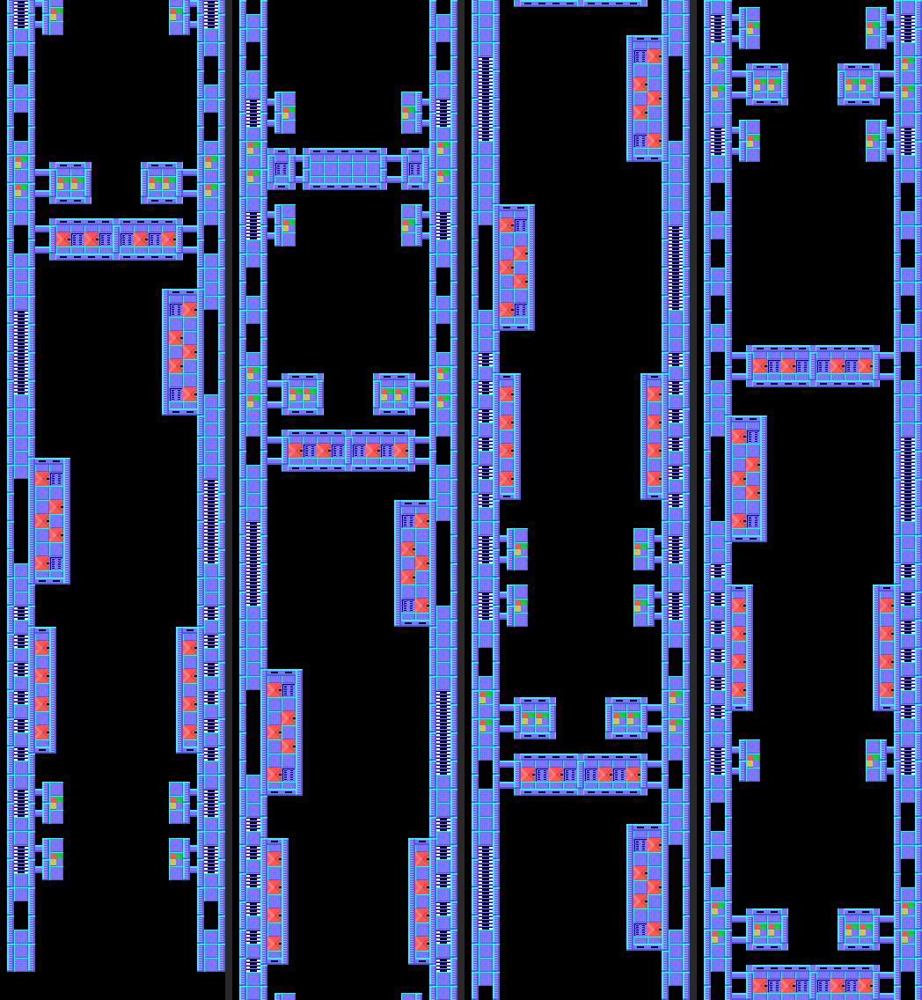
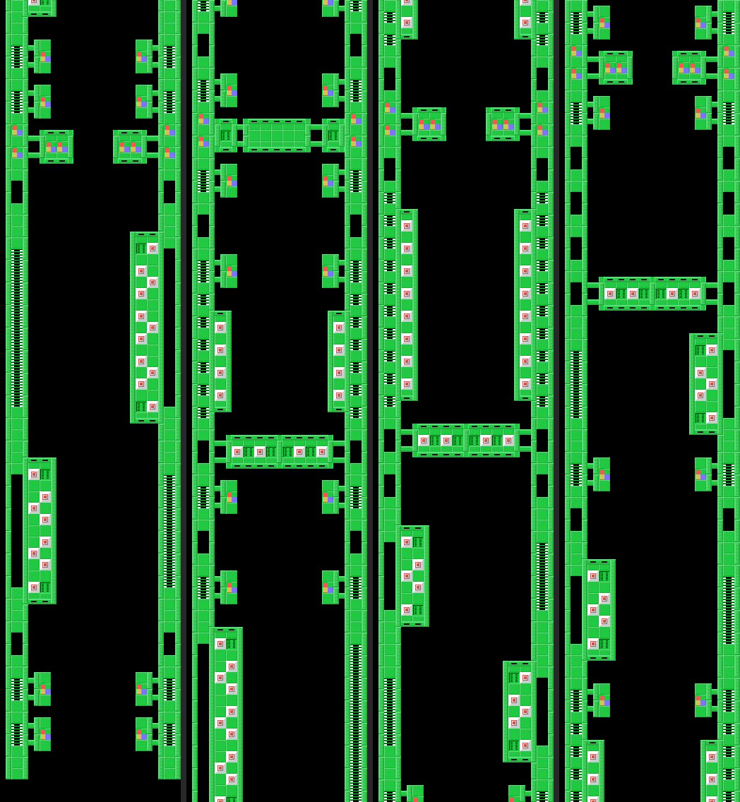
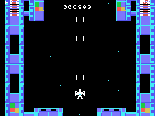
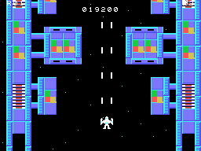
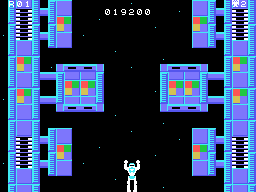
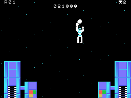

# Las rondas

Cada ronda es una pasada por la estación: la nave entra por abajo, la pantalla sube por la estación hasta su
final, la nave se transforma y pelea con el robot grande, y un recuento cuenta los blancos rotos. Después, la ronda
siguiente: cuatro estaciones con su dibujo y sus colores (la ronda & 3) y las oleadas de las ocho primeras rondas,
que después se repiten de la 4 a la 7 (`ronda_datos`, 0x4890).

## La estación

La estación no es una imagen: el juego la monta trozo a trozo mientras sube. Hay 16 **trozos** de 8 filas de 32
casillas, empaquetados (0x56D9), y cada ronda tiene una **lista** con los trozos en orden (0x4999); detrás va la
lista del final, igual para todas (0x4AA5). El scroll mete cada trozo por arriba fila a fila y se mueve con dos
tablas de nombres que se turnan: mientras una se ve, la otra se rellena por tercios (`tarea_scroll`, 0x54D9;
`tarea_mapa`, 0x5562). Las estrellas del fondo son ocho casillas con la estrella cada vez una fila más abajo
(`estrellas_casillas`, 0x614F).

Los mapas de esta página están montados con el código de la ROM (`tools/mapas.py`: el trozo 0, la lista de la
ronda y la del final, cada trozo desempaquetado con sus órdenes) y pintados con las casillas de la VRAM grabada en
openMSX en esa ronda. Van en cuatro tiras: la primera, a la izquierda, es el principio (abajo), y cada tira se lee
de abajo arriba, como sube la pantalla.

## Los enemigos

Salen en oleadas: cada ronda tiene una lista de clases (0x4AAD), y cada clase dice cómo salen y cómo se mueven
(la clase / 4, `tarea_oleada`, 0x696C, y `tarea_enemigos`, 0x6C1F). Hasta ocho a la vez:

| clases | salen | se mueven |
|---|---|---|
| 0-3 | de cuatro en cuatro por un lado | en espiral (`mueve_forma0`, 0x6C90) |
| 4-7 | por ocho sitios fijos | hacia abajo; la 5 de lado a saltos, la 6 en diagonal, la 7 hasta la fila de la nave |
| 8-11 | desde arriba, cada uno en su columna | hacia abajo; la 9 cae en picado sobre la nave, las demás tuercen hacia ella |
| 12-15 | desde arriba, cerca de la nave | en tres partes: recto, de lado hasta su columna y en picado |
| 16-19 | de cuatro en cuatro | en espiral, más abajo |

Disparan a la nave solo si está en su misma fila, columna o diagonal (`apunta`, 0x6F8E).

## Los blancos del suelo

Hay dos clases de casillas que se rompen con los disparos (`disparo_suelo`, 0x65DF): las **0xC8** (300 puntos),
que se cuentan para el recuento, y las **0xE0**, que solo se rompen una vez de cada dieciséis (1.000 puntos). Rotas,
quedan en su sitio las casillas 0x90-0x9F en las dos tablas de nombres y en la RAM.

## Las cápsulas

En el trozo 6 bajan tres **cápsulas** (`estado_capsulas`, 0x75EE). Cada disparo que les da las hace girar entre
cuatro dibujos; cuando las tres se paran, se miran (`capsulas_premio`, 0x771B): las tres en el primer dibujo dan
**una vida y disparos más rápidos** (8 puntos por cuadro en vez de 4); las tres en el otro, **los enemigos dejan de
disparar**; mezcladas, nada.

## El final: el robot grande

Al acabar la lista del final, la nave va sola al centro de la pantalla y se **transforma** en un robot
(`estado_fin_mapa`, 0x675F, y `estado_transforma`, 0x67BA). Entonces baja el **robot grande**, parpadea y va de
un lado a otro bajando poco a poco (`tarea_robot_grande`, 0x7199). La nave transformada se mueve igual y el botón
da un **puñetazo** (`tarea_robot_golpe`, 0x6898): cinco puñetazos lo rompen (`robot_grande_golpe`, 0x72AE). Si el
robot grande llega abajo, se va: la nave vuelve a ser nave y la estación otra vez, y cada vez que se escapa cuenta
(0xE0C3): desde la cuarta, los enemigos disparan el doble de deprisa y en todas las direcciones.

## El recuento

Roto el robot grande, una pantalla cuenta los blancos 0xC8 que había y los que se han roto, el porcentaje (**RATE**)
y el premio (**BONUS**), que pasa a los puntos de cien en cien (`recuento`, 0x73A4; `estado_bonus`, 0x7589).
El bucle mira seis tramos; con el 100 % no cabe en ninguno y se queda en el séptimo de la tabla:

| RATE | BONUS |
|---|---:|
| menos del 50 % | 0 |
| del 50 % | 5.000 |
| del 60 % | 10.000 |
| del 70 % | 15.000 |
| del 80 % | 20.000 |
| del 90 % | 30.000 |
| el 100 % | 100.000 |

