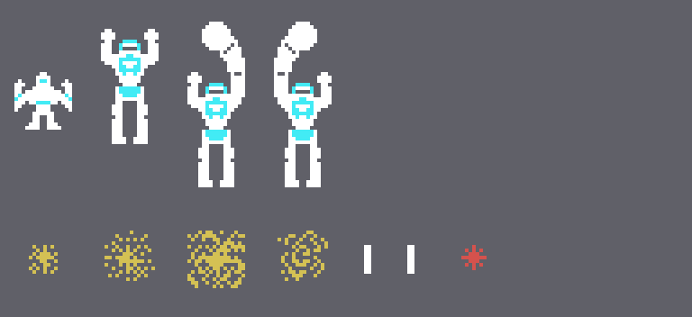
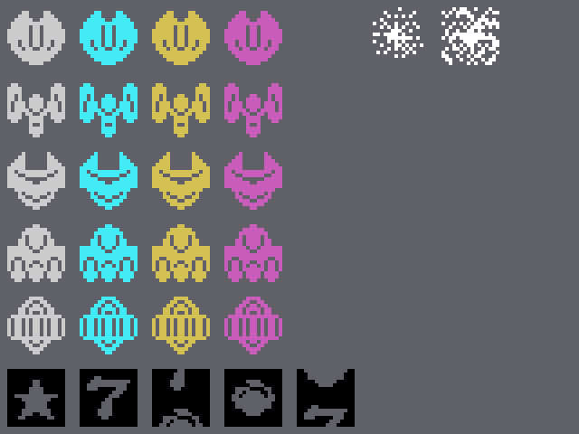
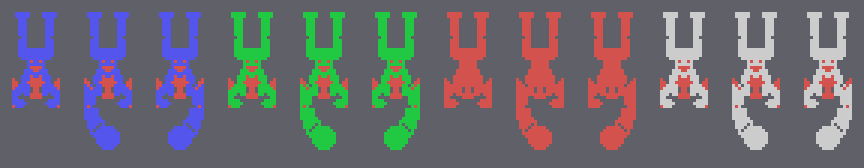
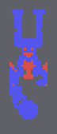

# Los sprites

Todo lo de esta página está **montado desde la ROM** con `tools/hojas.py`. El juego hace sus propios dibujos de
sprites en la VRAM, con copias en espejo (los bits de cada byte al revés), mitades cambiadas y copias vueltas del
revés (`pantalla_pon`, 0x7834, y `sprites_3c00`, 0x78D8), así que aquí esas dos rutinas se **ejecutan** con el Z80 de
`tools/bios.py` y los dibujos se toman de lo que dejan en 0x3800. Ninguna de estas imágenes es una captura.

**Cotejado con openMSX** en las cuatro grabaciones de esta web:

- la tabla de dibujos que deja la ROM ejecutada aquí (VRAM 0x3800-0x3F3F) es **idéntica** a la del juego en 30.269
  cuadros; en otros 972 están las letras de GAME OVER en 0x3D20-0x3DBF (el juego las copia allí de la fuente de la
  BIOS, 0x4953), y en 759 aún no se ha ejecutado `sprites_3c00`; **0 distintos**. Los puntos y las vidas
  (0x3F40-0x3FFF) los pinta el juego con las letras de la BIOS y aquí no se usan;
- la nave y su sombra (0xE219 y 0xE27D) casan en 22.246 cuadros, **0 distintos** (otros 48 con la sombra
  transparente, al final de la estación);
- la nave cambiada casa en 5.306 cuadros, **0 distintos** (otros 210 mientras entra o se transforma, con las piezas
  separadas);
- los enemigos (0xE2BD, el sprite 0xE245 + 4 × su número) llevan el dibujo y el color de su clase en **45.717
  cuadros, 0 distintos**;
- el robot grande, en sus 381 cuadros, **0 distintos**.

## La nave y el robot

La nave son dos sprites en el mismo sitio: 0x00 en blanco y su sombra 0x04 en cian (0x6276). Al final de la estación
se convierte en el robot (`estado_transforma`, 0x67BA): 0x80 con 0x84 debajo, en blanco, y la sombra 0x88 tres
puntos más abajo; cada ronda empieza también con este robot entrando a pie por la izquierda (0x626A) hasta que se
convierte en la nave. Con el botón el robot da puñetazos (`tarea_robot_golpe`, 0x6898): el cuerpo 0x98 con el brazo
0xA8 encima, o 0x9C con 0xB0, uno y otro. Abajo, la nave estallando (0xD8, 0xDC, 0xE0 y 0xE4 en amarillo oscuro,
`nave_explota` 0x63D2), su disparo (0x08, blanco) y el de los enemigos (0xD4, rojo oscuro):

## Los enemigos

El dibujo de cada enemigo sale de su clase: (clase & 0xFC) + 0x0C, y el color de la tabla de 0x6A05 por clase & 3:
gris, cian, amarillo oscuro y magenta (`sale_sprite`, 0x69E4). Cinco dibujos, uno por cada una de las cinco formas de
salir (`tarea_oleada`, 0x696C). Tocados, pasan a 0xDC en el cuadro 3 y a 0xE0 en el 11, en blanco, y se van en el 19
(`tarea_tocados`, 0x7071). Abajo, las cápsulas (0x6C-0x7C, negras: el dibujo es el hueco, `tarea_capsulas`
0x7635):

La nave estallando (0xD8 + 4 cada 8 cuadros, tres veces) y un enemigo tocado, al ritmo del juego:

## El robot grande

Cuatro sprites (0x70BD): 0x8C con 0x90 encima en el color de la ronda (0x70CD: azul oscuro, verde, rojo oscuro y
gris), 0x94 detrás en rojo oscuro, y un cuarto debajo, transparente. Cuando mueve los brazos
(`tarea_robot_grande_brazo`, 0x733D) el 0x8C pasa a 0xA0 con 0xAC debajo, o a 0xA4 con 0xB4, uno y otro; cada ronda,
quieto y con los dos brazos:

Los brazos 12 cuadros y después quieto 96, al ritmo del juego:

